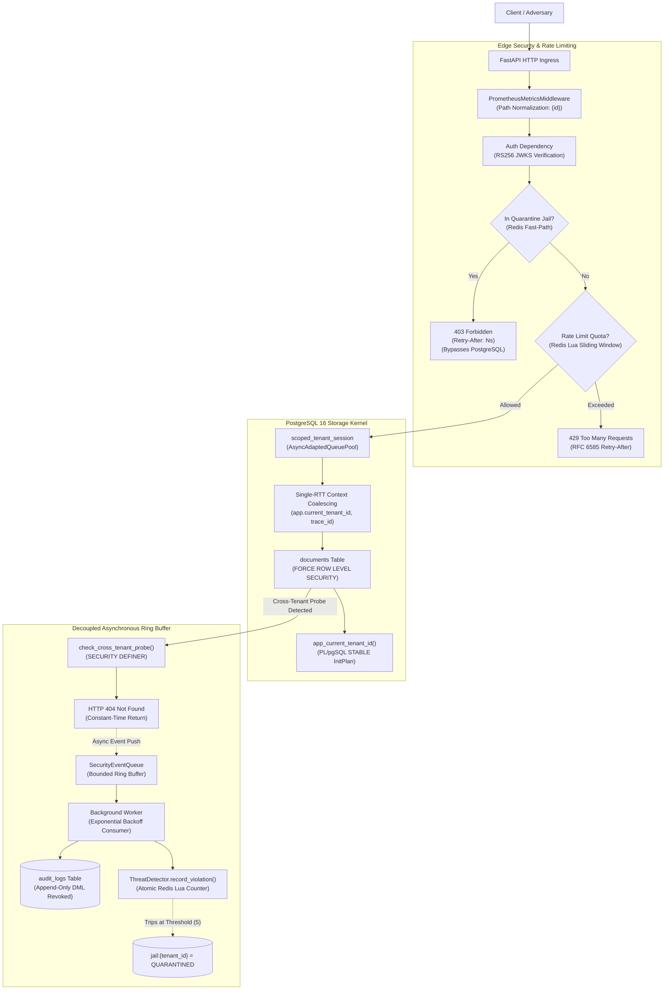

# SentinelCore

[](https://github.com/PyCQA/bandit)
[](https://github.com/pypa/pip-audit)
[](tests/)
[](https://www.python.org/)
[](https://www.postgresql.org/)
[](https://redis.io/)

**SentinelCore** is an enterprise multi-tenant backend architecture built with **FastAPI**, **PostgreSQL 16**, and **Redis 7**. It enforces storage-kernel tenant boundary isolation via non-inlined PL/pgSQL Row-Level Security (RLS), asymmetric RFC 7517/8725 RS256 JWKS authentication with SSRF-hardened outbound transports, atomic Redis Lua abuse mitigation, constant-time BOLA timing invariance, cancellation-shielded connection pooling, and cardinality-bounded Prometheus observability.

---

## System Invariants Matrix

| Invariant | Target Subsystem | Implementation Mechanism | Mathematical / Security Guarantee | Verification Proof |
| :--- | :--- | :--- | :--- | :--- |
| **Storage Boundary Isolation** | PostgreSQL 16 Kernel | `FORCE ROW LEVEL SECURITY` + `LANGUAGE plpgsql STABLE` | Non-inlined `InitPlan` evaluation; composite index scan pushdown `(tenant_id, id)` | [`test_pg16_rls_enforces_initplan_and_index_cond`](tests/test_adversarial_proofs.py) |
| **BOLA Timing Invariance** | HTTP Request Pipeline | Decoupled `SecurityEventQueue` ring buffer + definer probe | Constant-time HTTP 404 responses ($\Delta < 3.5\text{ms}$, Welch's t-test $p > 0.05$) | [`harness.py timing`](harness.py), [`test_bola_404_timing_indistinguishability`](tests/test_adversarial_proofs.py) |
| **Cancellation Wire Safety** | `asyncpg` Driver / Pool | `AsyncAdaptedQueuePool` + `asyncio.shield()` on rollback/close | Zero `InterfaceError: connection is busy`; zero GUC leakage across recycled sockets | [`test_client_abort_chaos_tcp_rst`](tests/chaos/test_client_abort_chaos.py) |
| **SSRF & Rebinding Defense** | Outbound JWKS Transport | `SSRFProtectedTransport` + DNS IP validation | Strict HTTPS; private, loopback, link-local (169.254.169.254), and multicast subnets rejected | [`test_ssrf_transport.py`](tests/test_ssrf_transport.py) |
| **Automated Threat Quarantine** | Redis 7 Circuit Breaker | Atomic Lua script + edge-tier `check_quarantine` | 5 probes trip circuit breaker; subsequent requests return 403 with `Retry-After` bypassing DB | [`harness.py breaker`](harness.py), [`test_telemetry_and_quarantine_e2e`](tests/chaos/test_telemetry_and_quarantine_e2e.py) |
| **Authoritative Rate Limiting** | Edge Middleware | Redis Lua sliding-window with `redis.call('TIME')` | Eliminates $2N$ boundary-burst attacks and container NTP clock drift; zero `CROSSSLOT` errors | [`test_concurrent_load_and_backpressure`](tests/chaos/test_concurrent_load.py) |
| **Bounded TSDB Cardinality** | Prometheus Metrics | Parameter normalization (`{id}`) + status categorization | Bounded label sets (`method`, `endpoint`, `status_class`); zero entity ID leaks | [`test_metrics.py`](tests/test_metrics.py) |

---

## Architectural Workflow



---

## Architectural Threat Model & Mitigations

### 1. Broken Object Level Authorization (BOLA / IDOR) & Timing Oracles
- **Threat:** An authenticated tenant queries document UUIDs belonging to other tenants. If the application logs violations synchronously, database round-trip latency creates a measurable timing oracle ($\Delta > 15\text{ms}$) allowing attackers to confirm resource existence.
- **Mitigation:**
  - Storage boundary enforced by PostgreSQL 16 `FORCE ROW LEVEL SECURITY` with non-inlined `LANGUAGE plpgsql STABLE` function `app_current_tenant_id()`. The query optimizer generates a single-execution `InitPlan` parameter, driving index scan pushdown into `idx_documents_tenant_id_id (tenant_id, id)`.
  - Hot-path audit logging is decoupled into `SecurityEventQueue`. Route handlers return `HTTP 404` immediately in constant time ($\Delta < 3.5\text{ms}$, confirmed by Welch's t-test).

### 2. Client Abort Sockets & Connection Pool Corruption
- **Threat:** High-frequency violent client disconnects (TCP RST) interrupt in-flight `asyncpg` queries, leaving connections in dirty protocol states and leaking tenant identities into pooled connections.
- **Mitigation:**
  - `AsyncAdaptedQueuePool` guarded by `asyncio.shield()` on `rollback()` and `close()`, paired with `pool_reset_on_return = "rollback"`.
  - Transaction settings applied with `is_local=true` via a single parameterized round-trip query (`COALESCED_CONTEXT_SQL`), ensuring all GUCs auto-revert upon transaction end.

### 3. Outbound SSRF & DNS Rebinding (GHSA-5x4x-2946-qr67)
- **Threat:** Attackers supply crafted JWKS URLs pointing to cloud metadata endpoints (`http://169.254.169.254/latest/meta-data/`) or internal RFC 1918 networks (`10.0.0.0/8`, `192.168.0.0/16`) to exfiltrate IAM credentials.
- **Mitigation:**
  - `SSRFProtectedTransport` intercepts all outbound JWKS requests, enforces HTTPS, resolves hostnames asynchronously via `getaddrinfo()`, and inspects all resolved IP addresses. Any request resolving to private, loopback, link-local, multicast, or reserved ranges raises `PermissionError` before socket connection.

### 4. Distributed Burst Abuse & Clock Drift
- **Threat:** $2N$ boundary-burst attacks exploit fixed-window rate limiters. Container time drift allows clients to bypass rate quotas.
- **Mitigation:**
  - Atomic Redis 7 Lua sliding-window counter using `redis.call('TIME')` as the authoritative clock authority.
  - Keys hash-tagged to `rate:{{{tenant_id}}}` to ensure 100% Redis Cluster compatibility without `CROSSSLOT` errors.

### 5. Automated Threat Detection & Circuit Breaking
- **Threat:** Automated scanners fire consecutive unauthorized probes across tenant boundaries.
- **Mitigation:**
  - The Redis Lua circuit breaker records violations. When a tenant hits 5 violations within 30 seconds, the tenant is transitioned into quarantine (`jail:{tenant_id} = QUARANTINED`).
  - Subsequent requests are rejected with `HTTP 403 Forbidden` and `Retry-After` at the FastAPI dependency boundary without querying PostgreSQL.

---

## Architecture Decision Records (ADRs)

Detailed architectural decisions, context, and formal rationales are documented in [`docs/adr/`](docs/adr/):

- [**ADR 0001:** Kernel-Enforced Row-Level Security with Non-Inlined PL/pgSQL Functions](docs/adr/0001-kernel-enforced-rls-plpgsql.md)
- [**ADR 0002:** Shielded Asynchronous Connection Pooling & Cancellation Safety](docs/adr/0002-shielded-connection-pooling.md)
- [**ADR 0003:** Ring-Buffer Telemetry Decoupling & Timing Oracle Elimination](docs/adr/0003-ring-buffer-telemetry-decoupling.md)
- [**ADR 0004:** Server-Authoritative Sliding-Window Rate Limiting](docs/adr/0004-server-authoritative-rate-limiting.md)

---

## Quickstart & Demonstration

### 1. Start Backing Infrastructure
Ensure Docker is running, then boot PostgreSQL 16 and Redis 7:
```powershell
docker compose up -d
```

### 2. Bootstrap Hardened Database Schema & Roles
Apply tightened database roles, RLS policies, definer probe functions, and permission revocations:
```powershell
python src/db/init_db.py
```

### 3. Run Turnkey Demonstration Harness (`harness.py`)

Execute the turnkey verification CLI out of the box against the local backend:

```powershell
# Proof 1: Verify BOLA timing indistinguishability (TTFB Delta < 3.5ms via Welch's t-test)
python harness.py timing --samples 25

# Proof 2: Verify automated threat containment and 404 -> 403 circuit breaking
python harness.py breaker
```

---

## Test & Audit Verification

### Comprehensive Test Suite (46 Tests)
```powershell
# Run full functional, adversarial, and chaos test suite
python -m pytest -v
```

### Dedicated Chaos & Load Suite
```powershell
# 1. 50 Concurrent Virtual Users Load & Rate Limiting Backpressure
python tests/chaos/test_concurrent_load.py

# 2. 100 Rapid Violent Client Disconnects (TCP RST Storm)
python tests/chaos/test_client_abort_chaos.py

# 3. End-to-End Adversarial Telemetry & Quarantine Circuit Breaker
python tests/chaos/test_telemetry_and_quarantine_e2e.py
```

### Static Analysis & Dependency Vulnerability Audits
```powershell
# Automated SAST security scan (Asserts 0 issues)
python -m bandit -r src/

# Strict dependency vulnerability audit (Asserts 0 known vulnerabilities)
python -m pip_audit --desc --strict
```
